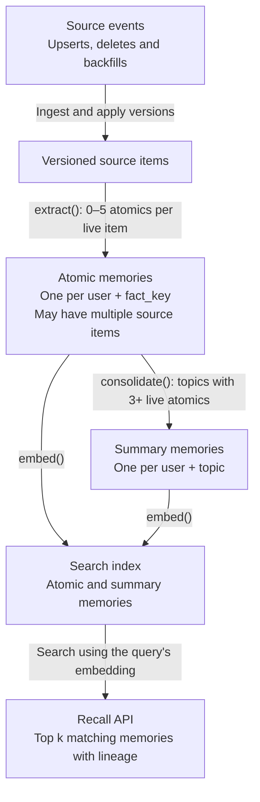

# Engramme Engineering Take-Home

Please complete two separate exercises:

1. **Memory service:** build a service that keeps memories accurate and searchable as source items are added, edited and deleted. This should take no more than 4 hours.
2. **Statistics:** analyze how duplicate requests affect batch latency. Allow another 30–45 minutes.

Both parts are required. Submit them in one repository and record one video demonstrating your service and explaining your statistics answers.

## Part 1: Build a memory service

### The problem

This exercise is a simplified take on the kind of problem we work on: a service that builds long-term memory from ingested personal data. Each source item is turned into small **atomic memories**. When enough atomic memories share a topic, they're merged into a **summary memory**. Every memory is embedded and searchable.

Doing this well on real data is hard at every stage:

- **Ingesting.** Events are retried, duplicated and reordered. The extraction step is slow, flaky and rate-limited.
- **Deduplicating.** The same fact often appears in several items and sources, such as a meeting in both a calendar invite and the email about it. It should become one memory that knows all of its sources.
- **Staying current.** When an item is edited, its memories and every summary built on them must change too, without rebuilding everything.
- **Keeping up.** Reconnecting a source replays thousands of items, and new events must not wait behind them.
- **Forgetting.** Deleting an item must remove what came from it, including its share of summaries, without losing facts that other sources still back.
- **Failing.** Processes crash in the middle of any of this.

Your job is to build the service that gets all of this right.

### At a glance

Atomic memories track their source items; summaries track their atomic memories. Use this **lineage** to update or remove affected memories and search entries after edits, deletes and disconnects.

`extract()` and `consolidate()` share a limit of 20 concurrent calls.

### What we give you

Everything in this section is in the `starter-kit/` folder. Its `README.md` explains how to run the sidecar and the harness.

| Component | What it does |
| --- | --- |
| `extract(item) -> list[AtomicMemory]` | Deterministic. Returns 0–5 atomic memories, each with a `fact_key`, a `topic` and text. Items that state the same fact yield the same `fact_key` and text, even across sources. Takes 50–200 ms and fails 2% of calls with a retryable error. |
| `consolidate(list[AtomicMemory]) -> SummaryMemory` | Deterministic and order-independent. A user's topic gets a summary while it has ≥ 3 live atomic memories. Same latency and failure profile as `extract`. |
| `embed(text) -> float[64]` | Deterministic hash-based embedding. Fast and never fails. |
| Rate limit | `extract` and `consolidate` share a budget of 20 concurrent calls. Calls beyond it fail with a retryable `429`. |
| Public test harness | Replays recorded workloads against your service over HTTP and runs a subset of our checks: `./harness run --scenario <name>`. The public scenarios are `basic`, `dupes`, `reorder`, `cross-source`, `edit`, `backfill`, `delete` and `crash`. |

A sidecar HTTP service serves `extract` and `consolidate` and enforces their latency, failures and rate limit. The kit includes thin Python and TypeScript clients; any other language can call the sidecar directly. The kit's `API.md` has exact request and response shapes. These functions are the only "intelligence" in the system; no ML knowledge is needed.

### The API you implement

All endpoints use JSON over HTTP. A 2xx response to a write means the write is durably accepted. Exact shapes, including the memory object, are in the kit's `API.md`.

| Endpoint | Meaning |
| --- | --- |
| `POST /v1/events` | One event from a source: `{user_id, source_id, item_id, version, kind, content?, occurred_at}`, where `kind` is `upsert` or `delete`. A `delete` here means the item was removed upstream. Events may be duplicated, reordered or retried. |
| `DELETE /v1/users/{user_id}/items/{source_id}/{item_id}` | The user asks the service to forget this item. |
| `POST /v1/users/{user_id}/sources/{source_id}/disconnect` | The user disconnects a source. |
| `POST /v1/users/{user_id}/sources/{source_id}/connect` | The user reconnects a source. The harness then replays a full backfill of that source as events. |
| `GET /v1/users/{user_id}/recall?q=…&k=…` | The top `k` memories (atomic and summary) by embedding similarity to `q`, each with its lineage. |
| `GET /v1/users/{user_id}/memories?cursor=…` | Every live memory for the user, in pages. The harness uses it to compare your state with the reference model. |
| `GET /v1/users/{user_id}/memories/{memory_id}` | One memory with its lineage: the source items it came from and, for a summary, the atomic memories it merged. |
| `GET /v1/health` | Returns 200 when the service is ready for traffic. |

### Guarantees

The hidden harness checks each of these at the load in the performance floor below.

#### Remembering

- **Ingest is idempotent and ordered.** A duplicate event changes nothing. An event whose version is less than or equal to the item's current version is ignored.
- **New items show up quickly.** Memories from an acknowledged event can be recalled within 5 seconds (p95), even while a 20,000-item backfill runs for another source.
- **One fact, one memory.** A user's atomic memories with the same `fact_key` are stored once, with every item behind them in their lineage.
- **Edits propagate.** A newer version of an item replaces its atomic memories and updates every summary built on them. A fact the new version still states keeps its memory ID.
- **Summaries stay current.** Once the system converges (see below), every topic with ≥ 3 live atomic memories has a summary built from exactly those, and no other topic has one.

#### Forgetting

- **Reads are clean after forgetting.** After a user delete or disconnect returns 2xx, no response to a request sent later contains text derived only from affected items. A memory that another live item still backs stays, with the forgotten item gone from its lineage. Cleanup may run in the background, but reads must already be clean.
- **Forgotten items stay forgotten.** An item the user deleted does not come back from a retried event or a reconnect backfill. The one open policy question is in the next section.
- **Disconnecting is not forgetting.** After disconnect and connect, backfilled items come back, except the ones the user deleted.

#### Under failure

- **The system survives crashes.** The harness sends `SIGKILL` to your processes at random moments and restarts them. No acknowledged write is lost, every guarantee still holds after restart, and no memory stays half-derived.
- **It is safe under concurrency.** The harness keeps up to 32 requests in flight across users, including an edit and a delete of the same item at the same moment.
- **It converges.** Once the harness stops sending, your memories must match a reference model's output for the same final logical state within 10 seconds, plus 1 second per 100 events in the scenario.

**Performance floor:** with 200,000 items across 500 users on a laptop, ingest sustains at least 200 events/s and recall p95 stays under 150 ms. This is a floor, not a competition.

### Decisions left to you

There is no single right answer to these. We look at the reasoning, and whether your code and demo agree.

- **Scheduling under the rate limit.** Backfills, live events, edits and summary rebuilds all compete for 20 calls. What goes first, and how do you keep any of them from starving?
- **Incremental consolidation.** When do you rebuild a summary, and how do you avoid rebuilding it on every change during a burst?
- **Delete, then a newer version.** If the user deletes an item and the source later sends a higher version of it (it was edited upstream), is that new content or the same forgotten item? Pick a policy and declare it in `takehome.json` as `{"redelete_policy": "permanent"}` or `{"redelete_policy": "newer_version_restores"}`. The harness tests whichever you declare.
- **Clean reads before cleanup finishes.** Filter at read time, purge synchronously, or something else. What does each cost?
- **Lineage and tombstones.** How you store lineage and find affected memories quickly, where tombstones live, how long they last, and how they interact with reconnects.
- **Retries and crashes.** How you make `extract` and `consolidate` calls safe to retry, and stop a slow call from committing a stale result.
- **Process and storage layout.** One process or several, and which store.

### Constraints and non-goals

- Use any language and any storage that runs locally.
- The service must start with `docker compose up` and pass `./harness run --scenario basic` with no other setup.
- The harness kills and restarts every container in your compose project except the ones you label `takehome.persistent=true`. Use that label for your database, not for your application processes.
- Do not use managed cloud services or real LLM or embedding APIs.
- Out of scope: authentication, UI, multi-region deployment, production hosting and ranking quality.

## Part 2: Statistics

Solve this separately from the service exercise. Use the assumptions below; no changes to your service or the starter kit are needed.

### Setup

An organization sends **100 requests from 100 users at once**. All requests begin CPU preprocessing immediately. Each independently takes **Uniform(50 ms, 400 ms)**. The GPU waits until every request has a preprocessing result, then processes the whole batch in exactly **1,000 ms**.

Assume enough CPU capacity for all originals and duplicates to start immediately without slowing each other. Ignore network latency, scheduling overhead, failures, and other batches.

**Batch latency** runs from arrival until the GPU finishes. **p95** is its 95th percentile across repeated independent batches.

### Level 1: Baseline

What is the p95 batch latency? Show how you derive the batch completion-time distribution from the individual preprocessing times.

### Level 2: Duplicate unfinished requests

At **200 ms**, start one duplicate of each request still preprocessing. Use whichever copy finishes first; launch no further copies. Each duplicate independently takes **Uniform(50 ms, 400 ms), measured from its own start time**. All original and duplicate durations are mutually independent.

1. What is the new p95 batch latency, and how much does it improve on Level 1? Account for the duplicate's later start.
2. What percentage of original requests do you expect to receive a duplicate?
3. For what percentage of **all original requests** do you expect the duplicate to finish first?
4. Among **requests that receive a duplicate**, what percentage have the duplicate finish first?

### Level 3: A larger batch

Repeat the exercise for **10,000 users sending one request each at once**, processed as one batch. All other assumptions stay the same, including the fixed 1,000 ms GPU time.

1. Calculate p95 with and without duplicates, and the improvement.
2. Do any of the three percentages from Level 2 change? Why?
3. Explain how batch size affects the benefit. Would you implement the duplicate packet strategy? Why or why not?

### Your answer

Show your reasoning, equations and numerical results for all three levels. Report latencies and improvements in milliseconds to at least three decimal places, and make each percentage's denominator clear.

Calculators and code are welcome. Simulation is optional; if you use it, explain the probability model, your method and its precision.

## What to submit

1. **Repository.** Share a private GitHub repo with the reviewers. Include your service code and a README with setup instructions.
2. **Statistics answers.** Put your answers in `STATISTICS.md` at the repo root, along with any calculation or simulation code.
3. **Video.** Record your screen with a voice-over and put an unlisted link (e.g. YouTube or Google Drive) at the top of the README. Cover both parts in one video. A camera and polished editing are optional. Include:

    - **Design:** your data model and lineage, scheduling under the rate limit, what a 2xx promises, edit and delete propagation, crash recovery, and what would change at 100× the data.
    - **Remembering, live:** two sources contributing to one fact with both in its lineage; an edit updating a summary while unchanged facts keep their IDs; a live event becoming recallable within seconds during a large backfill.
    - **Forgetting, live:** delete one source of a shared fact and show that the memory stays; delete the other and show that it disappears immediately and the summary is re-derived; reconnect and show that the deleted item stays forgotten.
    - **Failure, live:** use `kill -9` during processing and show recovery. Running the `crash` scenario and explaining what it proves also works.
    - **Decisions:** explain your Part 1 choices, tradeoffs and known limitations.
    - **Statistics:** walk through all three levels, showing your written work or code and explaining what the results mean.
